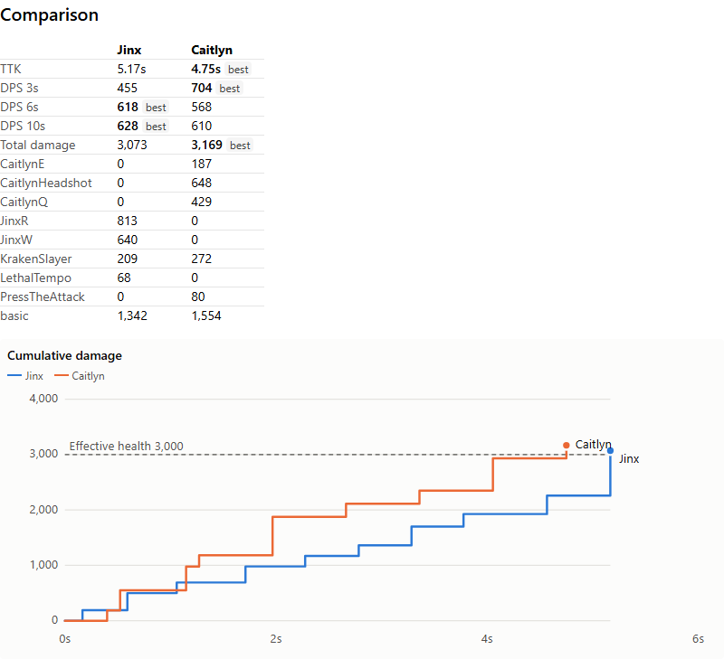

# LoL DPS Sim

A damage simulator for League of Legends marksmen. Build Jinx, Caitlyn, Ashe, Kai'Sa or Vayne with items, runes and skill ranks. Then see how fast each build kills a target dummy or any champion, side by side.

**Live:** https://jakeyizle.github.io/lol-dps-sim/



- A discrete-event fight simulation: attack windups, ability casts, buffs, cooldowns, mana and crits (expected value or seeded random runs).
- Every number comes from the game's own files for the current patch (via CommunityDragon and Data Dragon), with sourced corrections where the files are wrong or incomplete.
- Shows time to kill, DPS windows, a damage curve, a breakdown by source and an event log. You can also compare builds, see an item-count timeline, and run a build × target matrix.
- Your work is saved in the browser, and share links carry a whole comparison in the URL.

## Stack

TypeScript in a pnpm monorepo:

| Package                  | What it is                                                                  |
| ------------------------ | --------------------------------------------------------------------------- |
| `packages/engine`        | The simulator: stats, damage, effects, champion kits, items, runes, metrics |
| `packages/data`          | Typed, validated patch data (`generated/<patch>/*.json`)                    |
| `packages/data-pipeline` | Builds that data from the game files, with overrides and a drift report     |
| `apps/web`               | React 19 + Vite + Tailwind app; simulations run in Web Workers              |

Tests use Vitest and Playwright. Requirements live in `scenarios/*.md` as Given/When/Then, and every test is tagged with the scenarios it covers.

## Run, test, deploy

```sh
pnpm install
pnpm dev                    # app at http://localhost:5173/lol-dps-sim/
pnpm test                   # unit and component tests
pnpm test:e2e               # Playwright against a production build
pnpm lint && pnpm typecheck
pnpm scenarios:check --strict
pnpm data:update [patch]    # regenerate patch data (newest patch by default)
```

Pull requests run all of the checks above. Merging to `main` deploys to GitHub Pages. A scheduled workflow opens a PR when a new patch changes the data.

## Legal

LoL DPS Sim isn't endorsed by Riot Games and doesn't reflect the views or opinions of Riot Games or anyone officially involved in producing or managing Riot Games properties. Riot Games, and all associated properties are trademarks or registered trademarks of Riot Games, Inc.
